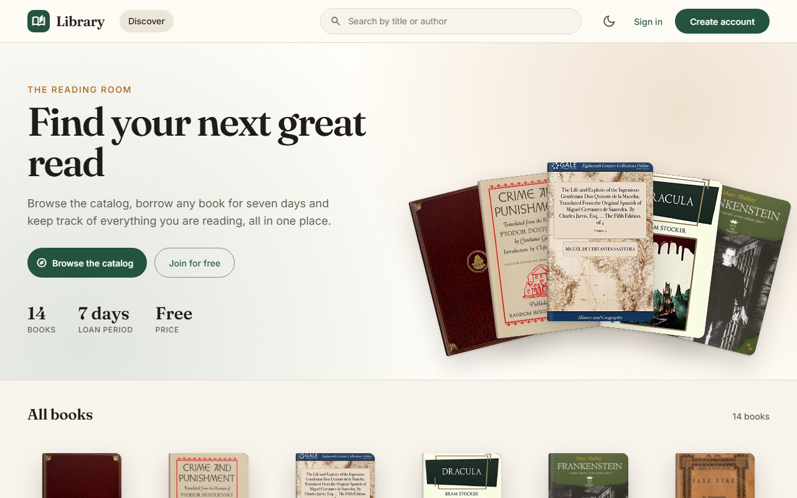
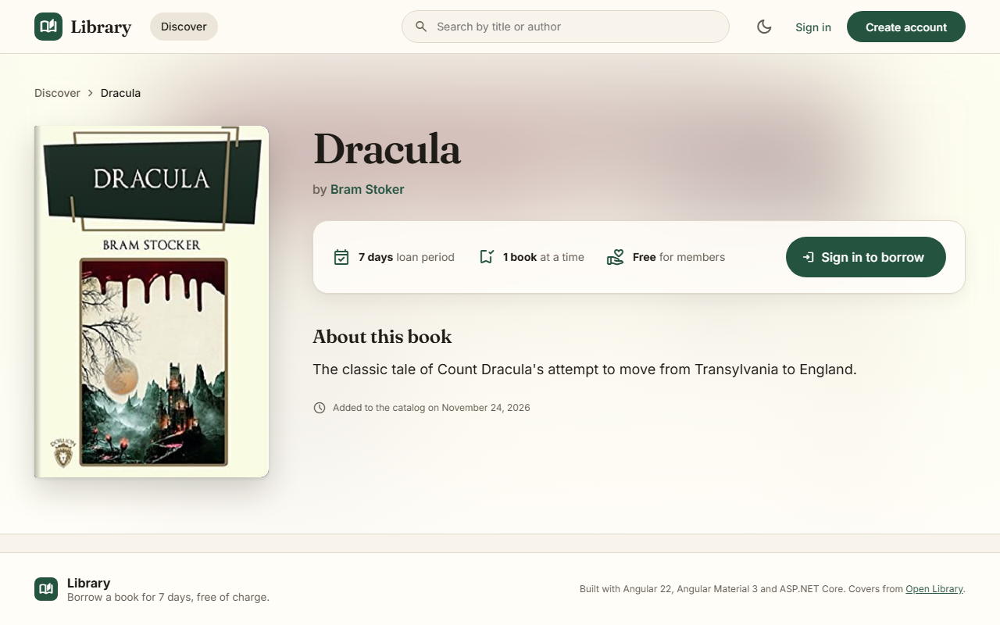
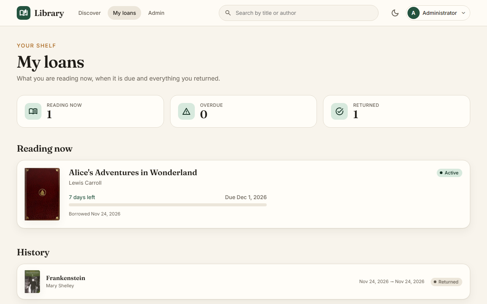
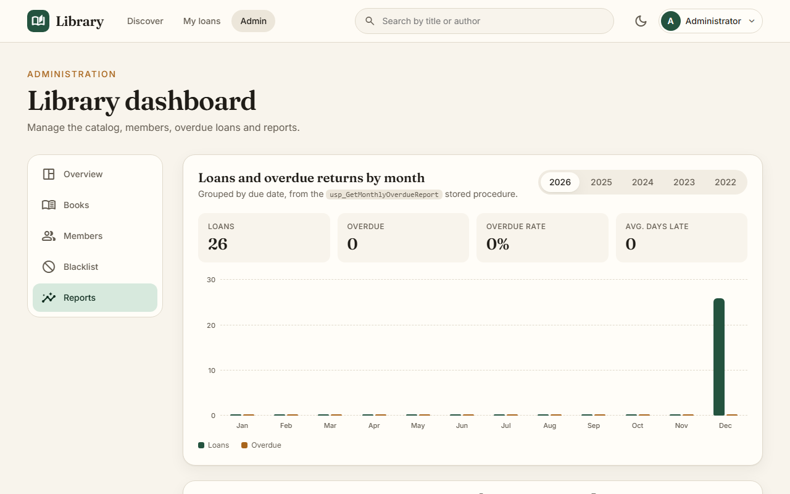
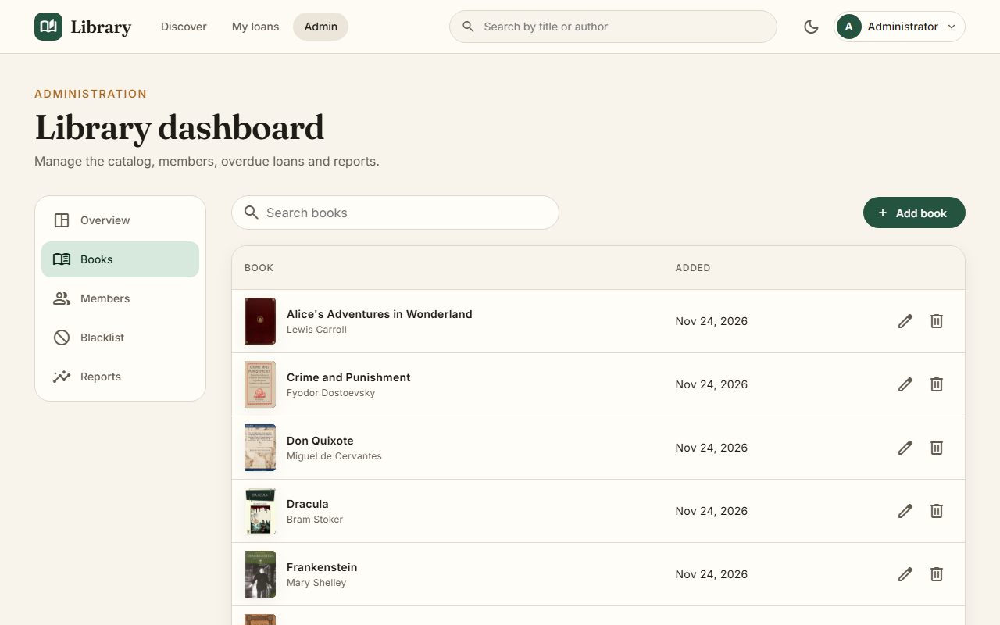
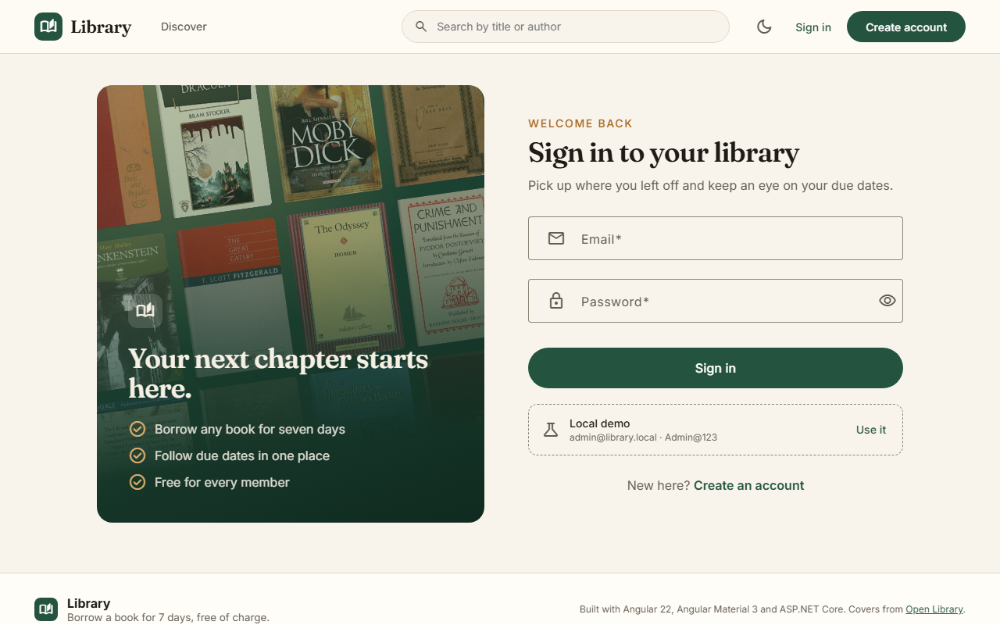
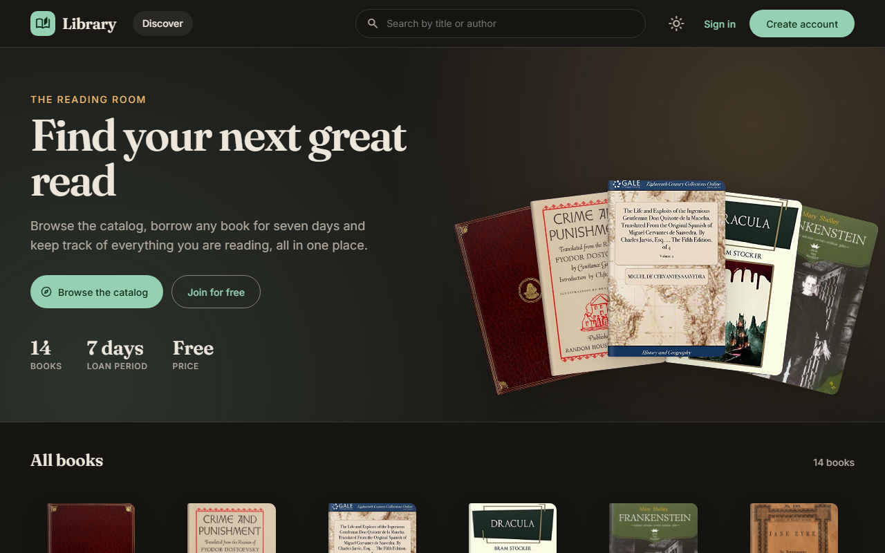
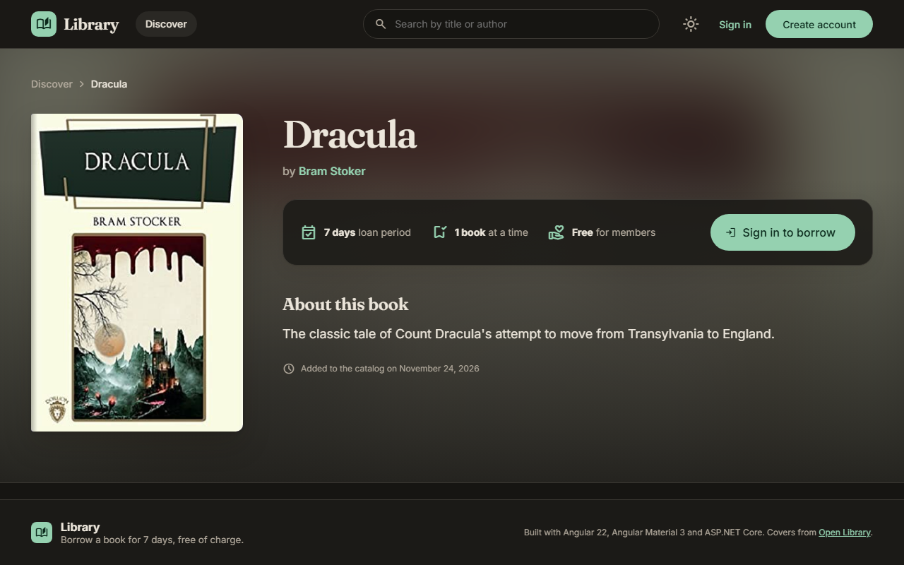
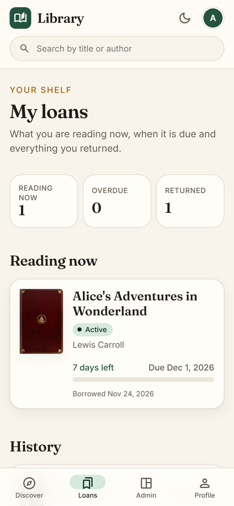
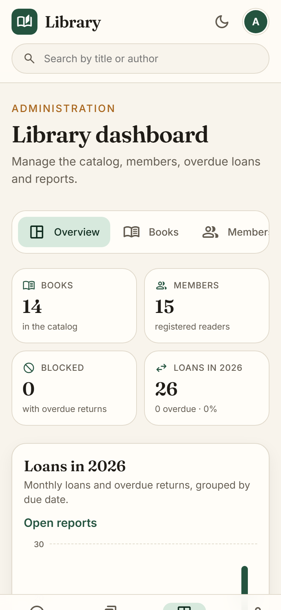

# Library Web


The front end of the **Library Management** system: browse the catalog, borrow books, follow your loans and, as an administrator, manage books, members, the blacklist and reports.

It talks to the [Library Management API](https://github.com/reinansilveira/BibliotecaProjectBook) (ASP.NET Core, SQL Server, RabbitMQ).



| Book page | My loans |
|---|---|
|  |  |

| Admin dashboard | Reports |
|---|---|
|  |  |

| Manage books | Sign in |
|---|---|
|  |  |

| Dark theme | Book page, dark |
|---|---|
|  |  |

| Mobile catalog | Mobile book page | Mobile loans | Mobile dashboard |
|---|---|---|---|
|  |  |  |  |

## Features

- **Catalog** with an editorial hero, a fan of featured covers, a search bar in the header, a paginated book grid and loading skeletons.
- **Real book covers** from the [Open Library Covers API](https://openlibrary.org/dev/docs/api/covers), found by title and author and cached in the browser; books without a cover get a generated, typeset cover instead.
- **Book page** with a blurred-cover backdrop, the loan rules, a one-click "Borrow this book" and more books by the same author.
- **Accounts**: sign up, sign in (with a show/hide password toggle), profile editing and sign out.
- **My loans**: what you are reading now with a due-date progress bar ("3 days left", "2 days overdue"), and your history.
- **Administration** (admins only): a dashboard with key numbers, a monthly chart and the top books; add, edit and remove books; search members and register returns; review and unblock the blacklist or run the overdue check; reports with yearly totals, an accessible bar chart and a ranking.
- **Light and dark themes** (follows the system, with a toggle that is remembered) and a **mobile layout** with a bottom navigation bar.
- **Errors** returned by the API (`ProblemDetails`) are shown as friendly messages; every list has loading, empty and error states.

## Highlights

| Area | Implementation |
|---|---|
| Framework | Angular 22, standalone components, **signals**, new control flow (`@if`, `@for`, `@switch`), lazy-loaded routes, component input binding for route params |
| Design system | **Angular Material 3** with a custom warm "paper and ink" palette built on `mat.theme` + `mat.theme-overrides` with `light-dark()` tokens, Fraunces and Inter typography, Material Symbols, responsive layout with a mobile bottom bar |
| Covers | `CoverService` queries Open Library through `HttpBackend` (so the bearer token never leaves for a third party), shares in-flight requests and caches results in `localStorage`; the lookup is switched on by an injection token, so unit tests never hit the network |
| Authentication | Access token kept **in memory**, refresh token in storage; a functional **HTTP interceptor** adds the bearer token and, on a 401, **refreshes the session once** (concurrent requests share the same refresh) and retries the request |
| Session restore | `provideAppInitializer` restores the session from the refresh token on reload |
| Authorization | `authGuard`, `adminGuard` and `guestGuard`; admin links only for admins (the API enforces the rules too) |
| State | Loading, error and loaded states modeled as a discriminated union (`LoadState<T>`) |
| Quality | ESLint with angular-eslint and style rules (no unnecessary `else`, no nested ternaries, braces always required), Prettier formatting checked in CI, Dependabot |
| Tests | **79 unit tests** with Vitest (78% line coverage of the whole app) and **14 end-to-end tests** with Playwright against the real API |
| Delivery | Multi-stage Docker image served by **nginx**, which also proxies `/api` to the back end (no CORS needed); GitHub Actions |

## Project structure

```
src/app
├── core
│   ├── api            Typed API clients and models
│   ├── auth           AuthService, interceptor, guards, token storage
│   ├── covers         Open Library cover lookup
│   ├── http           Error messages and LoadState helper
│   ├── notifications  Snackbar notifications
│   └── theme          Light and dark theme
├── layout             Shell (header, search, account menu, mobile bottom bar) and 404 page
├── shared             Book cover, loan status chip, empty state, confirm dialog
└── features
    ├── catalog        Catalog and book page
    ├── auth           Sign in and sign up
    ├── account        My loans and profile
    └── admin          Dashboard, books, members, blacklist and reports (chart, ranking)
e2e                    Playwright tests
nginx                  nginx configuration for the Docker image
```

## Getting started

Requirements: Node.js 22 and the API running on `http://localhost:5080` (see the API repository: `docker compose up --build`).

```bash
npm install
npm start
```

Open http://localhost:4200. In development, `proxy.conf.json` forwards `/api` to the API. The local admin account is `admin@library.local` / `Admin@123`.

## Scripts

| Command | Description |
|---|---|
| `npm start` | Development server with the API proxy |
| `npm run build` | Production build |
| `npm run lint` | ESLint |
| `npm run format` / `npm run format:check` | Prettier |
| `npm run test:ci` | Unit tests (Vitest) with coverage, single run |
| `npm run e2e` | End-to-end tests (Playwright); the API must be running |

## Tests

**Unit tests (79)** cover:

- the authentication service (login, shared refresh, session restore, logout), the interceptor (bearer header, refresh and retry after a 401, ending the session when the refresh fails) and the guards;
- every API client (URLs, parameters and the book cache), the Open Library cover lookup and the theme service;
- the pages: catalog, book page (borrowing, refused loans, more by the author), sign in, sign up, My loans (due-date progress), the header, the admin dashboard, the blacklist and the reports;
- the chart scale, the loan progress math, error messages, notifications and shared components.

Coverage is measured over **every file in `src/app`**, not only the ones the tests import: **78% of lines, 86% of branches**. The remaining screens (admin books and members, profile and dialogs) are exercised by the end-to-end tests. CI uploads the HTML report as an artifact.

**End-to-end tests (14)** run in Chromium against the real API:

- browsing and searching the catalog as a visitor, and switching to the dark theme
- creating an account, keeping the session after a reload, wrong credentials, signing out
- borrowing a book and seeing it in My loans; a second member cannot borrow the same book
- members are kept out of the admin area
- an admin adds a book and opens every administration section

The tests sign in many times from one IP, so start the API with a higher sign-in rate limit:

```bash
AUTH_RATE_LIMIT=100000 docker compose up -d --build   # in the API repository
npx playwright install chromium
npm run e2e
```

## Docker

```bash
docker compose up --build
```

The app is served by nginx on http://localhost:8081. `API_URL` (default `http://host.docker.internal:5080`) is where nginx forwards `/api` requests. nginx sends the client address in `X-Forwarded-For`; when the API is only reachable through this proxy, set `RateLimiting__TrustForwardedHeaders=true` on the API so its sign-in rate limit applies per user instead of per proxy.

## Deployment

In the cloud the app is hosted on **GitHub Pages**. The API address and the base path (the repository name) are set at build time:

```bash
npx ng build --configuration production --base-href /BibliotecaProjectBook-Web/ --define "API_BASE_URL='https://<name>.runasp.net'"
```

Without `API_BASE_URL` (local development and Docker) the app calls `/api` on its own origin. The [Deploy workflow](.github/workflows/deploy.yml) runs after CI passes on `main`, builds with the `API_BASE_URL` repository variable, copies `index.html` to `404.html` so deep links work, and publishes the result to GitHub Pages. The step-by-step guide lives in the API repository (`docs/deploy.md`).

## Continuous integration

GitHub Actions checks formatting and runs lint, unit tests with coverage, the production build and the Docker build on every push. [Dependabot](.github/dependabot.yml) opens weekly pull requests for npm packages, GitHub Actions and the Docker base images. A second job checks out the API repository, starts it with Docker Compose (API, SQL Server and RabbitMQ) and runs the Playwright tests against it.
