# Library Web


The front end of the **Library Management** system, a Goodreads-style library: browse and filter the catalog, borrow printed books or **read e-books in the browser**, join waiting lists, rate and review books, follow fines and reading stats, get **real-time notifications** and, as an administrator, run the whole library from a dashboard.

It talks to the [Library Management API](https://github.com/reinansilveira/BibliotecaProjectBook) (ASP.NET Core, SQL Server, RabbitMQ, SignalR), version `/api/v1`.


| Genres, filters and sorting | Waiting list |
|---|---|
| 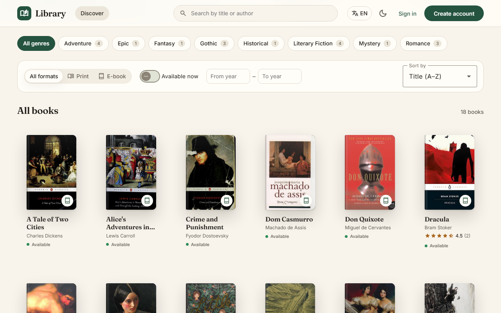 | 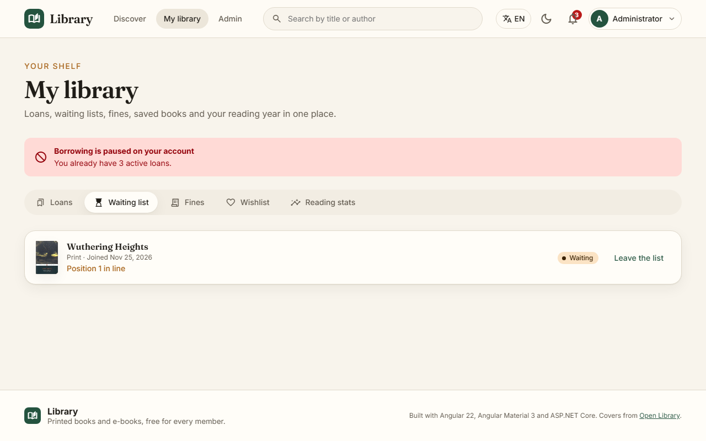 |

| Book page | Reader reviews |
|---|---|
|  | 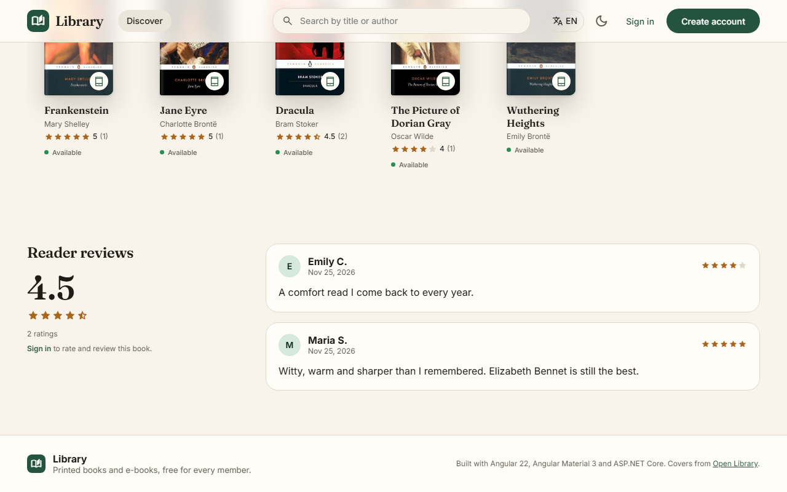 |

| My library | E-book reader |
|---|---|
| 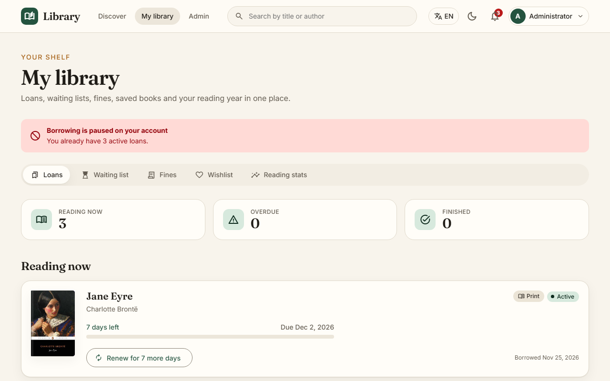 | 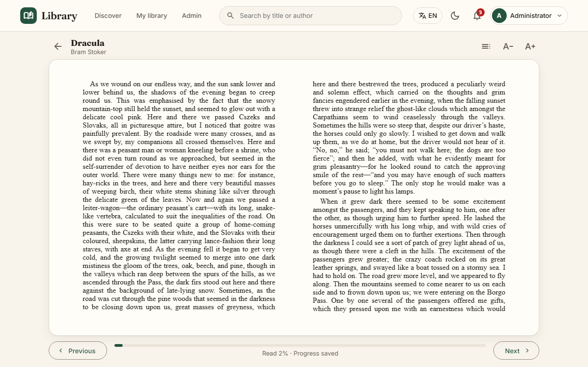 |

| Reading stats | Real-time notifications |
|---|---|
| 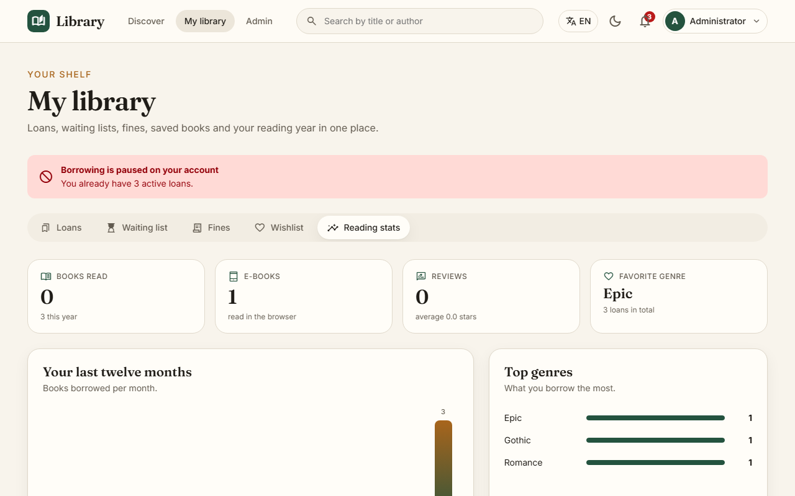 | 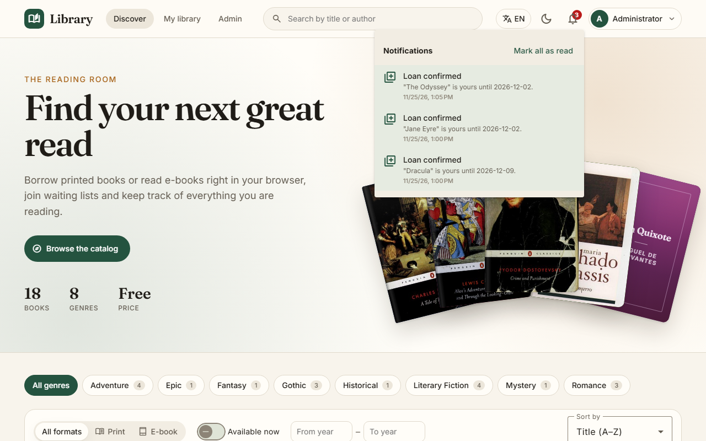 |

| Admin dashboard | Add a book by ISBN |
|---|---|
| 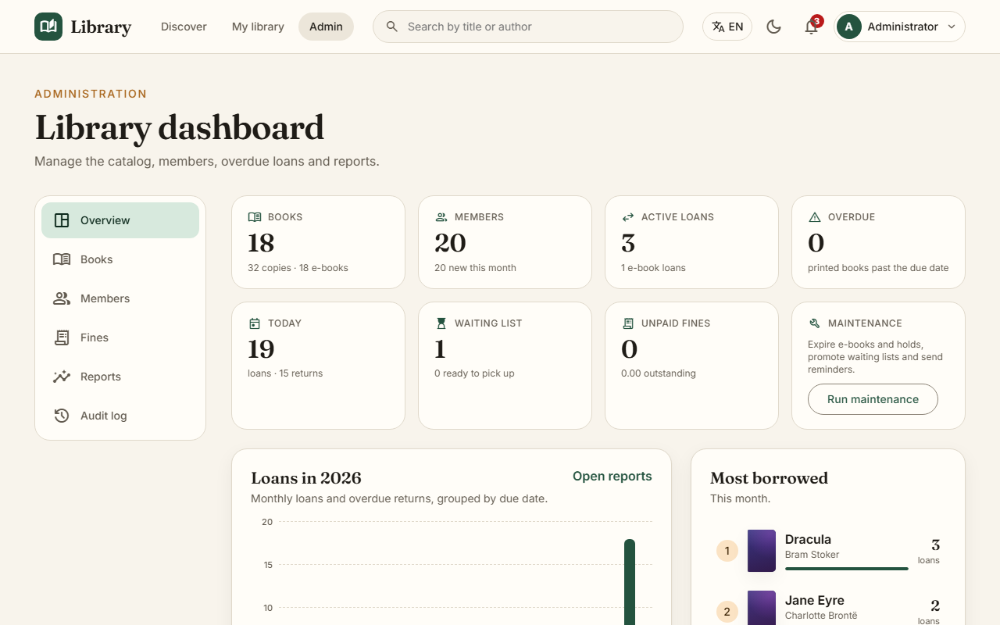 | 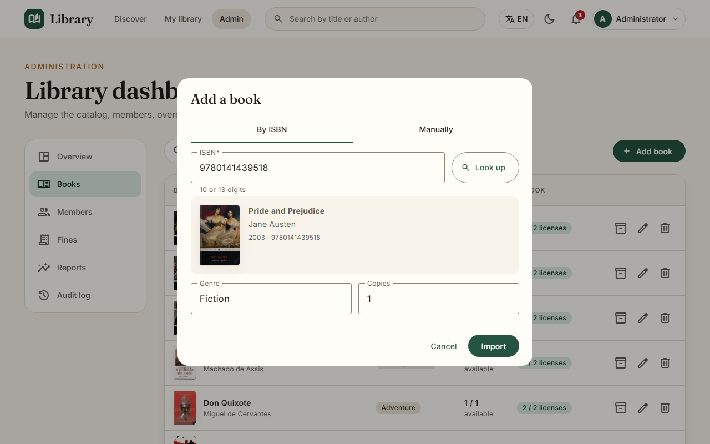 |

| Copies, e-book and waiting list | Audit log |
|---|---|
| 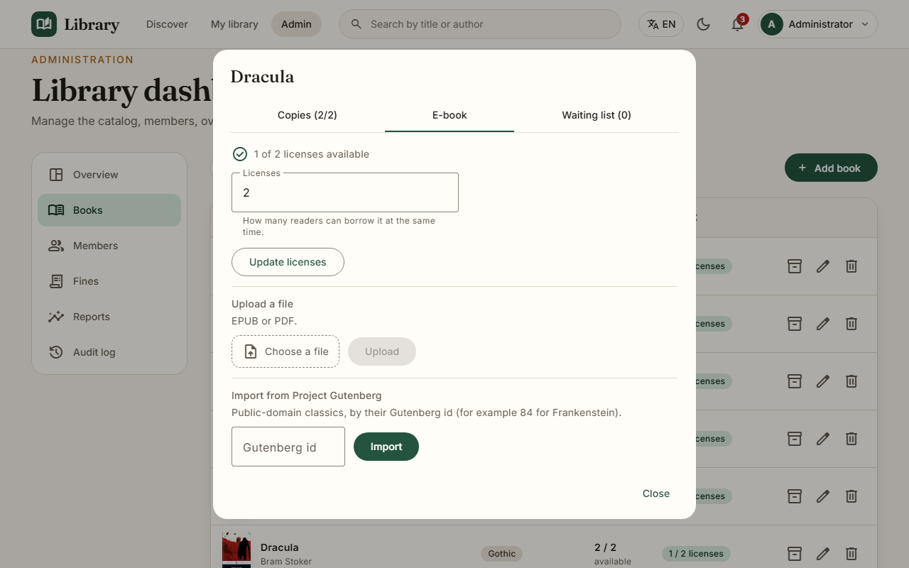 | 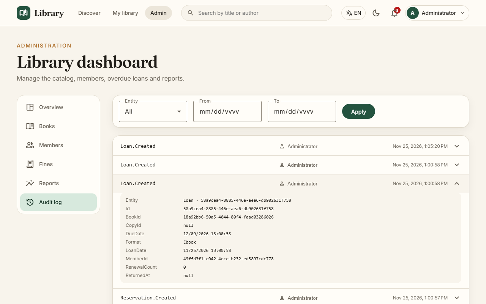 |

| Reports and CSV export | Sign in, Português (Brasil) |
|---|---|
|  | 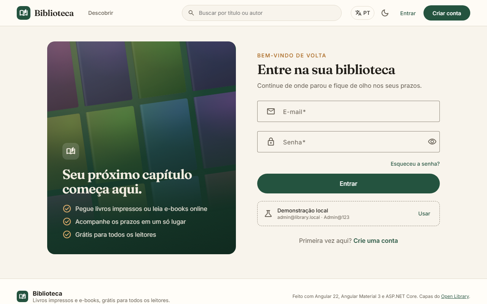 |

| Português (Brasil) | Dark theme |
|---|---|
|  |  |

| Mobile catalog | Mobile book page | Mobile library | Mobile dashboard |
|---|---|---|---|
|  |  |  |  |

## Features

**For readers**

- **Catalog** with an editorial hero, genre chips with counts, filters (format, available now, publication years), sorting (title, newest, best rated, most popular, year), loading skeletons and pagination. Every filter lives in the URL, so results can be shared.
- **Search as you type** in the header: an accessible combobox (`role="combobox"`, arrow keys, Enter) with book suggestions and covers.
- **Book page**: real cover, star rating, genre, ISBN and year, availability per format ("1 of 2 available"), **borrow a printed copy or an e-book**, or **join the waiting list** when every copy is out; "Readers also read" and "More by this author" shelves; a heart to save it to the **wishlist**.
- **Reviews**: average rating, paged reviews, and a star picker to publish, update or delete your own review (only readers who borrowed the book can review it).
- **E-book reader** in the browser (EPUB with [epub.js](https://github.com/futurepress/epub.js), PDF with the browser viewer): pages, table of contents, font size, dark theme, keyboard arrows, and reading progress saved automatically and resumed on the next visit.
- **My library**: loans with due-date progress, one renewal, "Continue reading" and early return for e-books; waiting lists with your position and the 48-hour pick-up window; fines with a simulated payment; wishlist; and **reading stats** (books this year, favorite genre, a twelve-month chart and top genres). A banner explains when borrowing is paused (overdue books, unpaid fines or too many loans).
- **Notifications**: a bell with the unread count, the latest notifications and "mark all as read", plus **real-time** delivery through **SignalR** with a snackbar ("Your book is ready", "Fine issued"...).
- **Accounts**: sign up, sign in, forgot / reset password, email confirmation (with resend), change password and profile editing.

**For administrators**

- **Dashboard** from `/reports/dashboard`: books, copies and e-books, members, active and overdue loans, today's activity, waiting lists, unpaid fines, top books of the month, the monthly chart and a "Run maintenance" button.
- **Books**: add a book **by ISBN** (details and cover from Open Library) or manually; edit and remove; manage **copies** (add, withdraw), the **e-book** (upload EPUB/PDF, import from **Project Gutenberg**, change licenses) and see the **waiting list**.
- **Members** with their loans (register returns) and email confirmation status; **fines** filtered by status, with waive; the **audit log** with expandable changes; **reports** with yearly totals, a bar chart, a ranking and **CSV export**.

**Everywhere**

- **English and Brazilian Portuguese**, switched at runtime (texts, dates, numbers, page titles, paginator and API error messages). The first visit follows the browser language.
- **Light and dark themes**, a **mobile layout** with a bottom navigation bar, and loading, empty and error states on every list.

## Highlights

| Area | Implementation |
|---|---|
| Framework | Angular 22, standalone components, **signals**, new control flow (`@if`, `@for`, `@switch`, `@let`), lazy-loaded routes, component input binding for route and query params, zoneless |
| Design system | **Angular Material 3** with a custom warm "paper and ink" palette (`mat.theme` + `mat.theme-overrides` with `light-dark()` tokens), Fraunces and Inter typography, Material Symbols |
| Real time | `NotificationCenter` loads unread notifications and opens a **SignalR** connection (lazy-loaded `@microsoft/signalr`, `accessTokenFactory`, automatic reconnect); the connection factory is an injection token, so tests use a fake hub |
| E-books | The reading link is signed by the API, so the file is fetched through `HttpBackend` without the bearer token; epub.js is lazy-loaded behind an `EPUB_ENGINE` token and progress is debounced and saved on leave |
| Covers | `coverUrl` from the API, with an Open Library lookup (through `HttpBackend`, cached in `localStorage`) and a generated, typeset cover as fallbacks |
| Internationalization | A small signal-based `I18n` service with `t`, `localDate` and `localNumber` pipes (English texts are the keys), a localized `TitleStrategy` and `MatPaginatorIntl`, and `npm run i18n:check`, run in CI, which extracts every translated text and fails when a Portuguese translation is missing, unused or has different placeholders |
| Authentication | Access token kept **in memory**, refresh token in storage; a functional **HTTP interceptor** adds the bearer token and, on a 401, **refreshes the session once** (concurrent requests share the same refresh) and retries |
| Performance | 600 kB initial bundle (145 kB transferred): epub.js, SignalR, the admin area and every page are lazy chunks; the header search avoids `MatAutocomplete` to keep forms out of the initial bundle |
| Quality | ESLint with angular-eslint and style rules (no unnecessary `else`, no nested ternaries, braces always required), Prettier and the translation check in CI, Dependabot |
| Tests | **124 unit tests** with Vitest (**82% line coverage** of the whole app) and **17 end-to-end tests** with Playwright against the real API |
| Delivery | Multi-stage Docker image served by **nginx**, which also proxies `/api` and the `/hubs` WebSocket to the back end; GitHub Actions and GitHub Pages |

## Project structure

```
src/app
├── core
│   ├── api            Typed clients for /api/v1 and models
│   ├── auth           AuthService, interceptor, guards, token storage
│   ├── covers         Open Library cover lookup
│   ├── http           Error messages and LoadState helper
│   ├── i18n           I18n service, pipes, pt-BR dictionary, title strategy, paginator
│   ├── notifications  Snackbar notifier and the real-time NotificationCenter
│   ├── theme          Light and dark theme
│   └── wishlist       Wishlist store
├── layout             Shell (header, search combobox, notifications, menus, mobile bar)
├── shared             Book cover, stars, availability, status chip, empty state, dialogs
└── features
    ├── catalog        Catalog, book page and reviews
    ├── auth           Sign in, sign up, forgot / reset password, email confirmation
    ├── account        My library (loans, waiting list, fines, wishlist, stats) and profile
    ├── reader         E-book reader
    └── admin          Dashboard, books (ISBN import, copies, e-book), members, fines,
                       reports (chart, ranking, CSV) and audit log
scripts                Translation check
e2e                    Playwright tests
nginx                  nginx configuration for the Docker image
```

## Getting started

Requirements: Node.js 22 and the API running on `http://localhost:5080` (in the API repository: `docker compose up -d --build`).

```bash
npm install
npm start
```

Open http://localhost:4200. In development, `proxy.conf.json` forwards `/api` and the `/hubs` WebSocket to the API. The local admin account is `admin@library.local` / `Admin@123`.

## Scripts

| Command | Description |
|---|---|
| `npm start` | Development server with the API proxy |
| `npm run build` | Production build |
| `npm run lint` | ESLint |
| `npm run format` / `npm run format:check` | Prettier |
| `npm run i18n:check` | Checks that every text has a pt-BR translation with the same placeholders |
| `npm run test:ci` | Unit tests (Vitest) with coverage, single run |
| `npm run e2e` | End-to-end tests (Playwright); the API must be running |

## Tests

**Unit tests (124)** cover every API client, authentication (service, interceptor, guards), translations, notifications (including a fake SignalR hub), the wishlist store and every page: catalog filters, book page (print, e-book, waiting list, shelves), reviews, My library (loans, renewals, waiting lists, fines, wishlist, stats), the e-book reader (with a fake epub.js engine), account recovery, the admin dashboard, books (ISBN import, manual form, copies), fines, audit log and reports.

Coverage is measured over **every file in `src/app`**, not only the ones the tests import: **82% of lines, 82% of branches**. CI uploads the HTML report as an artifact.

**End-to-end tests (17)** run in Chromium against the real API: browsing, searching, search suggestions, genre and format filters, the dark theme and Portuguese; sign up, session restore, wrong credentials and sign out; borrowing a printed copy and seeing it in My library; the waiting list when every copy is out; members kept out of the admin area; an admin adding a book and opening every section.

The tests sign in many times from one IP, so start the API with a higher sign-in rate limit:

```bash
AUTH_RATE_LIMIT=100000 docker compose up -d --build   # in the API repository
npx playwright install chromium
npm run e2e
```

## Docker

```bash
docker compose up --build
```

The app is served by nginx on http://localhost:8081. `API_URL` (default `http://host.docker.internal:5080`) is where nginx forwards `/api` and `/hubs`. nginx sends the client address in `X-Forwarded-For`; when the API is only reachable through this proxy, set `RateLimiting__TrustForwardedHeaders=true` on the API so its sign-in rate limit applies per user instead of per proxy.

## Deployment

In the cloud the app is hosted on **GitHub Pages**. The API address and the base path (the repository name) are set at build time:

```bash
npx ng build --configuration production --base-href /BibliotecaProjectBook-Web/ --define "API_BASE_URL='https://<name>.runasp.net'"
```

Without `API_BASE_URL` (local development and Docker) the app calls `/api/v1` and `/hubs` on its own origin. The [Deploy workflow](.github/workflows/deploy.yml) runs after CI passes on `main`, builds with the `API_BASE_URL` repository variable, copies `index.html` to `404.html` so deep links (including the `/reset-password` and `/confirm-email` links sent by email) work, and publishes the result to GitHub Pages.

## Continuous integration

GitHub Actions checks formatting and translations and runs lint, unit tests with coverage, the production build and the Docker build on every push. [Dependabot](.github/dependabot.yml) opens weekly pull requests for npm packages, GitHub Actions and the Docker base images. A second job checks out the API repository, starts it with Docker Compose (API, SQL Server and RabbitMQ) and runs the Playwright tests against it.
